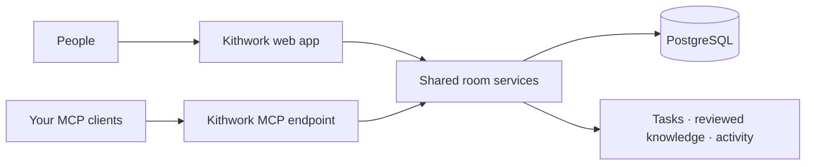

# Kithwork

<p align="center">
  
</p>

<p align="center">
  <strong>One shared workspace. Your agents. Your rules.</strong><br />
  Give people and their AI clients a common place for tasks, reviewed knowledge, and room activity.
</p>

<p align="center">
  <a href="https://github.com/yunusarda-sudo/kithwork-workspace/stargazers"></a>
  
  
  
  
</p>

> **🚧 Early-stage MVP · Self-hostable, not production-ready.** Kithwork has no hosted service. Backup/restore and systemd behavior passed isolated Linux checks; a clean production deployment and remote Claude/ChatGPT MCP compatibility have not. **No open-source license has been selected**, so public visibility does not grant permission to use, modify, or redistribute this code.

## ✨ Shared context, human-led

Each person joins with their own account and connects the AI client they choose. Agents can read room context and, when explicitly authorized, contribute tasks or propose knowledge. Kithwork does **not** run or wake agents, share private chat histories, or approve knowledge for people.

| 🧭 People stay in control | 🧠 Knowledge keeps its history | 🔐 Rooms have boundaries | 🔌 Bring your own agent |
| --- | --- | --- | --- |
| Owners approve knowledge versions; agents cannot make the decision for them. | New versions are appended instead of silently replacing what came before. | Application authorization and PostgreSQL row-level security protect room-scoped operations. | Connect compatible MCP clients to the server your team operates. |

## 🗺️ How Kithwork fits together



The shared pool is intentionally focused: room membership, tasks, versioned knowledge, and recorded activity. Agents do not automatically claim work or message one another, so people coordinate tasks that are already in progress.

## ✅ What works today

- Email/password accounts with database-backed sessions.
- Rooms with owner/member roles and hashed invitations. A shared invite can admit up to 100 people, expires after seven days, and can be revoked by its owner.
- Room-scoped task lists with optimistic version checks; stale updates return `409` rather than silently overwriting newer work.
- Append-only knowledge versions; only a room owner can approve a specific version.
- PostgreSQL row-level security alongside application authorization.
- MCP Streamable HTTP at `/api/mcp`, using OAuth 2.1, PKCE, resource-bound tokens, and per-tool scopes.
- Durable room activity events.

## Current limits

- There is no hosted instance, outbound email delivery, file storage, realtime push, or agent scheduling/wakeup.
- Agents do not automatically claim tasks or message each other. People must coordinate work that is already in progress.
- External Claude and ChatGPT OAuth, tool discovery, refresh, and revoke behavior have not yet passed client acceptance testing. See the [agent connection guide](docs/guides/CONNECT_AGENT_TO_MCP.md) for the exact boundary.
- The self-host bundle has been exercised in an isolated Linux VM for backup/restore and systemd behavior. A clean-server production deployment, offsite restore, freshness alerting, and production RPO/RTO are not verified. See [self-hosting and recovery](docs/guides/SELF_HOSTING.md).
- The product license, contribution policy, and public security-reporting channel are not decided/configured.

Do not use this project for sensitive production data until the deployment, security, recovery, and external-client acceptance gates are closed.

## Quick start

### Requirements

- Node.js 22 or later and npm.
- PostgreSQL 16 or later running locally.
- A local PostgreSQL account allowed to create the development roles and database.

### Run with local PostgreSQL

From the repository root:

```sh
./scripts/setup-local-db.sh
cd apps/web
npm ci
npm run db:migrate
npm run dev
```

Open [http://localhost:3200](http://localhost:3200), create an account, then create a room and invite collaborators. The setup script creates separate local owner, migration, and runtime database roles and writes generated credentials to the ignored `apps/web/.env.local` file. It does not print those credentials. Keep the file private; never reuse its local credentials on a server.

### Run with Docker Compose

Requirements: Docker Engine with the Compose plugin. From the repository root:

```sh
cp .env.example .env
```

Edit `.env` and replace all secret placeholders with distinct random values. Then run:

```sh
docker compose up -d db
docker compose --profile tools run --rm migrate
docker compose up -d web
```

The development stack binds the app to `127.0.0.1:3200` and PostgreSQL to `127.0.0.1:55432`. It is for local development; do not expose it directly to the internet. For a self-host deployment, follow the [Linux deployment and recovery guide](docs/guides/SELF_HOSTING.md).

## Connect an MCP client

For a client running on the same machine as the local development server, configure its MCP URL as:

```text
http://localhost:3200/api/mcp
```

The browser opens a local sign-in and explicit consent flow. The client must support MCP `2025-11-25` stateless HTTP and OAuth authorization code with PKCE. Available tools are `list_rooms`, `list_tasks`, `create_task`, `update_task`, `list_knowledge`, `propose_knowledge`, `approve_knowledge`, and `get_recent_activity`.

For friends or cloud-hosted agents connecting from another machine, localhost will not work. They need an approved HTTPS deployment reachable by their client, their own Kithwork account, and membership in the same room. Follow [Connect agents to one shared MCP workspace](docs/guides/CONNECT_AGENT_TO_MCP.md); that guide does not claim that remote Claude or ChatGPT compatibility has been verified.

Room membership and owner permissions apply to both web and MCP requests. A browser session cookie is not an MCP bearer token. Never share OAuth tokens, invitation tokens, `.env` files, or database passwords.

## Back up and restore a local database

From `apps/web/`, create a private custom-format dump:

```sh
npm run db:backup
```

By default, the dump is written under the ignored root `backups/` directory with owner-only file permissions. To restore a trusted dump, provide its path:

```sh
npm run db:restore -- ../../backups/<dump-name>.dump
```

Restore creates a separate database named `agent_collab_hub_restore_...`; it does not replace the active database. See the [self-host recovery guide](docs/guides/SELF_HOSTING.md) for the server workflow and its operational limits.

## Development

Run from `apps/web/`:

```sh
npm run dev
npm run lint
npm run typecheck
npm run build
npm run db:generate -- --name describe-change
npm run db:migrate
```

Schema changes belong in Drizzle source plus a reviewed migration. `db:migrate` uses the production Drizzle ORM migrator. Schema generation and Studio use the pinned CLI in a temporary tool directory. Never edit a migration after it has been applied to a shared or non-disposable database; add a new migration instead.

## Project documents

- [Architecture direction](docs/architecture/ADR-0001-architecture-direction.md)
- [Roadmap and acceptance gates](docs/plans/ROADMAP.md)
- [Self-hosting, deployment, backup, and recovery](docs/guides/SELF_HOSTING.md)
- [Connect agents to one shared MCP workspace](docs/guides/CONNECT_AGENT_TO_MCP.md)
- [Open-source landscape and runtime research](docs/research/OPEN_SOURCE_LANDSCAPE.md)

## Contributing and license

The project has not selected a license or published contribution rules yet. Until that decision is made, please open a discussion with the maintainers before preparing or relying on a contribution. Do not assume that public repository access grants rights to use, modify, or redistribute the code.

## Security

Kithwork treats room content and MCP tool results as untrusted input. Do not put credentials, private chat histories, or data you cannot safely expose to all members of a room into this MVP. A private vulnerability-reporting channel has not been configured; do not use this project as a production service until the security and operational review is complete.
